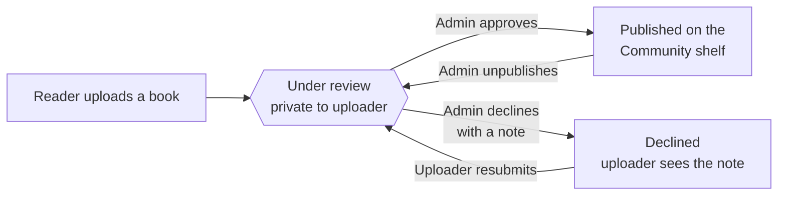

<p align="center">
  
</p>

<p align="center">
  <a href="https://shelfspace-woad.vercel.app"></a>
  
  
  
</p>

<p align="center">
  <b><a href="https://shelfspace-woad.vercel.app">Open the live site</a></b> ·
  <a href="#-features">Features</a> ·
  <a href="#-screenshots">Screenshots</a> ·
  <a href="#-quick-start">Quick start</a> ·
  <a href="#-deploy-your-own">Deploy</a> ·
  <a href="#%EF%B8%8F-how-publishing-works">Publishing</a>
</p>

---

**Shelfspace** turns plain `.txt` and `.md` files into a cozy, dimensional reading experience. Upload a book, give it a cover, and read it in a two-page 3D book that turns real pages, with soft paper sounds if you like. Books stay private until an admin approves them for the public **Community shelf**.

It is a small Node.js app with no framework and no build step. The same code runs as an ordinary server (`npm start`) or as a serverless function on Vercel, where the live site is hosted. It keeps data in a local JSON file out of the box, or in Postgres when you set `DATABASE_URL`; the live site uses [Neon](https://neon.tech).

<p align="center">
  
</p>

## ✨ Features

<table>
<tr>
<td width="50%" valign="top">

### 📖 A reader that feels like a book
- The cover **swings open** on its spine when you start reading
- Pages turn as **real 3D leaves** with light and shadow
- Page edges thicken on the side you have already read
- The book **leans toward your mouse**, like holding it in your hands
- Pages **re-flow to fit your screen**, with three text sizes

</td>
<td width="50%" valign="top">

### ✍️ Plain text, printed-book typography
- `Chapter 1`, `Part Two`, `Prologue` and `#`/`##` headings become **chapters**
- Each chapter opens on a fresh page with a **drop cap**
- Running heads show the book title and current chapter
- A **☰ Contents** panel lets you jump between chapters
- Markdown bold, quotes and `---` rules are tidied up

</td>
</tr>
<tr>
<td width="50%" valign="top">

### 🎧 Sound and atmosphere
- Soft **paper sounds** for turning, opening and closing
- An optional **☂ rain ambience** for cozy reading
- All audio is synthesized in the browser: no audio files
- Your sound choice is remembered on that device

</td>
<td width="50%" valign="top">

### 🛡️ Admin-approved community shelf
- New uploads stay **private and under review**
- Admins **approve & publish** or **decline with a note**
- Uploaders see the note and can **resubmit**
- Dashboard with counts, search, word counts and a **Readers** tab
- Promote other admins, unpublish, delete or **export everything**

</td>
</tr>
</table>

<table>
<tr>
<td width="50%" valign="top">

### 🔐 Real accounts
- Sign up, sign in, sign out, and **sign out of all devices**
- **Password reset** and **email verification** by email link
- Sessions survive restarts, expire after 30 days, and are stored only as hashes
- Change your name or password, **download your data**, or **delete your account**
- A short **getting started** checklist for new readers

</td>
<td width="50%" valign="top">

### 🧯 Safe by default
- **Rate limits** on sign-in, sign-up, resets and uploads, plus a short lockout after repeated wrong passwords
- **Spam protection**: a hidden honeypot field, verified email before uploading, and a cap of 5 books waiting for review
- Strict **Content Security Policy**, HSTS, same-origin checks on every change
- **Row level security** on every Postgres table
- No API keys or secrets ever reach the browser

</td>
</tr>
<tr>
<td width="50%" valign="top">

### 📊 Built-in insights
- **Cookieless analytics**: page view counts per day, no IPs, Do Not Track honored
- **Error tracking** for browser and server errors, right in the admin dashboard
- Site status at a glance (storage, email)

</td>
<td width="50%" valign="top">

### 🌐 A proper website
- Real URLs (`/library`, `/community`, `/account`...) with **page titles**
- **Meta descriptions**, Open Graph cards, canonical links, `robots.txt` and `sitemap.xml`
- A custom **404 page**, a **privacy policy** and **terms of use**
- Loading skeletons, clear error messages and inline form validation
- A bottom navigation bar on phones

</td>
</tr>
</table>

Also included: salted PBKDF2 passwords, reading progress that saves as you go, six cover styles or your own image (with alt text), library search (<kbd>Ctrl</kbd>/<kbd>⌘</kbd>+<kbd>K</kbd>), swipe on touch screens, and reduced-motion support.

## 📸 Screenshots

<table>
<tr>
<td colspan="2"></td>
</tr>
<tr>
<td width="50%"><p align="center"><sub><b>Your library</b>: covers, progress and review status</sub></p></td>
<td width="50%"><p align="center"><sub><b>Community shelf</b>: published books anyone can read</sub></p></td>
</tr>
<tr>
<td width="50%"><p align="center"><sub><b>Admin review</b>: approve, decline with a note, or delete</sub></p></td>
<td width="50%"><p align="center"><sub><b>Contents</b>: jump straight to any chapter</sub></p></td>
</tr>
<tr>
<td width="50%"><p align="center"><sub><b>Sign in</b> or create an account</sub></p></td>
<td width="50%" align="center"><p align="center"><sub><b>On a phone</b>: tap or swipe to turn</sub></p></td>
</tr>
</table>

## 🚀 Quick start

You need [Node.js](https://nodejs.org) 18 or newer.

```bash
git clone https://github.com/digvijay165/Shelfspace.git
cd Shelfspace
npm install
npm start
```

Open **http://127.0.0.1:4173**, create an account and add a `.txt` or `.md` book. Without email set up, verification and password reset links are printed in the terminal.

**Become the admin locally:** create `admin-email.txt` beside `server.js` containing your email *before* you sign up. The file is git-ignored. Or promote an existing account:

```bash
npm run admin:promote -- you@example.com
```

Want sample books to play with? Start with `DEMO_SEED=1` to fill an empty library with four original short stories:

```bash
DEMO_SEED=1 DATA_FILE=./demo-data.json npm start
```

## 🌍 Deploy your own

Shelfspace needs a Postgres database when it is hosted. A free one from [Neon](https://neon.tech) or [Supabase](https://supabase.com) is plenty; copy its connection string (`postgresql://...`, the pooled one on Neon). Tables are created on first start, and an existing `data.json` is imported automatically into an empty database.

### ▲ Vercel (recommended)

[](https://vercel.com/new/clone?repository-url=https://github.com/digvijay165/Shelfspace&env=DATABASE_URL,ADMIN_EMAIL)

1. Click **Deploy with Vercel** and sign in with GitHub.
2. Fill in `DATABASE_URL` (the connection string) and `ADMIN_EMAIL` (the email you will sign up with; that account becomes the site owner).
3. Optional: add `DEMO_SEED=1` for the sample shelf, and a [Resend](https://resend.com) API key as `RESEND_API_KEY` with `MAIL_FROM` so verification and reset emails are actually sent.
4. When the deploy finishes, open your `vercel.app` link and create your account with that email.

Or from your computer, with the [Vercel CLI](https://vercel.com/docs/cli):

```bash
npx vercel link
npx vercel env add DATABASE_URL production
npx vercel env add ADMIN_EMAIL production
npx vercel deploy --prod
```

How it runs there: [`vercel.json`](vercel.json) sends pages and the API to one function, [`api/index.js`](api/index.js), and serves images, scripts and styles straight from Vercel's CDN. There is no instance-hour limit and nothing to keep awake. The site address is picked up automatically; set `APP_URL` if you add a custom domain. The function runs in Portland (`pdx1`), next to a Neon database in AWS US West 2; change `regions` in `vercel.json` to the Vercel region closest to your database.

Vercel may run several copies of the function at once. Each copy checks a shared version number in the database before every request and reloads only when another copy has saved something, so every visitor sees the same library. Sign-in rate limits are counted per copy, so they are a little looser than on a single server.

### 🖥️ Render, or any Node host

[](https://render.com/deploy?repo=https://github.com/digvijay165/Shelfspace)

Click **Deploy to Render**, fill in the same `ADMIN_EMAIL` and `DATABASE_URL`, and open your `onrender.com` link when it finishes. The included [`render.yaml`](render.yaml) sets everything else (`HOST`, `TRUST_PROXY`, the `/healthz` health check and the demo shelf). Anywhere else, run `npm start` with `HOST=0.0.0.0`, `TRUST_PROXY=1` behind an HTTPS proxy, and the variables above.

Run one server per database: a long-running server does not watch for changes made by other servers, so do not point Render and Vercel at the same database at once.

> [!IMPORTANT]
> Without `DATABASE_URL`, data lives on the server's disk, and on Render's free plan that disk is wiped on every restart or redeploy. The admin **Insights** tab warns you when this is the case.

> [!NOTE]
> Without `RESEND_API_KEY`, email links are written to the server log (Render's **Logs** tab, Vercel's **Logs**) instead of being sent, and uploads do not require a verified email. Free Render services also sleep after 15 minutes idle; the next visit takes about a minute to wake. Let them sleep: a workspace gets 750 free instance hours a month across all its free services, and once they run out Render suspends every free web service until the next month.

### 🩺 Health checks

- **`/healthz`** answers `ok` whenever the server process is up. Render uses it to decide whether a deploy succeeded. It deliberately does not touch the database, so a database outage does not put the server into a restart loop.
- **`/api/health`** checks the database (with a 3 second timeout) and recent saves, and returns JSON:

  ```json
  { "status": "ok", "version": "1.0.0", "uptimeSeconds": 5021,
    "checks": { "database": { "kind": "postgres", "status": "ok", "latencyMs": 4 },
                "writes": { "status": "ok", "pending": 0 }, "email": { "status": "ok" } } }
  ```

  `status` is `ok`, `degraded` (the last save failed) or `down` (the database is unreachable, HTTP `503`). Point an uptime monitor such as [UptimeRobot](https://uptimerobot.com) at it to get an alert when something breaks, but only on a paid instance: frequent checks keep a free Render service awake around the clock and use up its free hours. Results are cached for 5 seconds, and error details, memory use and counts are shown only to admins in **Insights → Site status**.

### 💾 Backups

Neon and Supabase keep automatic point-in-time backups of your database. You can also take your own snapshot at any time; it includes password hashes, so keep it somewhere private:

```bash
DATABASE_URL=postgres://... npm run backup -- --keep 14
```

Backups are written to `backups/` (git-ignored). To restore one, run `npm run restore -- backups/<file>.json` to preview, then add `--yes`. Add `--replace` to clear existing data first. Admins can also download a JSON export from the dashboard, and every reader can download their own data from **Account settings**.

## 🗂️ How publishing works



Only published books are ever served publicly. Every admin endpoint checks the signed-in role on the server, and the site owner (`ADMIN_EMAIL`) can never lose admin access.

## ⚙️ Configuration

| Variable | Default | What it does |
| --- | --- | --- |
| `PORT` | `4173` | Port to listen on |
| `HOST` | `127.0.0.1` | Interface to bind; use `0.0.0.0` on a host |
| `DATABASE_URL` | none | Postgres connection string. When set, everything is stored in Postgres |
| `DATA_FILE` | `./data.json` | Where data is stored when there is no `DATABASE_URL` |
| `ADMIN_EMAIL` | contents of `admin-email.txt` | The site owner's email, who always has admin access |
| `APP_URL` | the Render or Vercel address, else localhost | Public address used in email links, canonical links and the sitemap |
| `RESEND_API_KEY` | none | Sends verification and reset emails through Resend. Also turns on "verify before uploading" |
| `MAIL_FROM` | `Shelfspace <onboarding@resend.dev>` | Sender for account emails (use an address on a domain you verified in Resend) |
| `CONTACT_URL` | this repo's issues | Where the privacy policy and terms send questions |
| `TRUST_PROXY` | off (always on on Vercel) | Set to `1` behind an HTTPS proxy so cookies are `Secure` and client IPs are used for rate limits |
| `DEMO_SEED` | off | Set to `1` to add sample books when the library is empty |
| `DATABASE_SSL` | on for remote hosts | Set to `0` to connect without TLS, or `1` to force it |

Copy [`.env.example`](.env.example) for a starting point. All of these stay on the server; none are sent to the browser.

## ⌨️ Reader controls

| Action | How |
| --- | --- |
| Turn the page | <kbd>→</kbd> / <kbd>←</kbd>, <kbd>Page Down</kbd> / <kbd>Page Up</kbd>, click a page, or swipe |
| First / last page | <kbd>Home</kbd> / <kbd>End</kbd> |
| Contents | **☰** in the reader header |
| Text size | **Aa** cycles small, medium and large |
| Sounds / rain | **♪** and **☂** |
| Close the book | <kbd>Esc</kbd> |
| Search your library | <kbd>Ctrl</kbd>/<kbd>⌘</kbd> + <kbd>K</kbd> |

## 🧱 Project structure

```text
Shelfspace/
├── server.js            # HTTP server, JSON API, auth, review workflow, pages
├── api/index.js         # Vercel entry point around the same handler
├── vercel.json          # Vercel routing: pages and API to the function, assets to the CDN
├── lib/
│   ├── store.js         # Postgres or JSON file storage, with write-through cache
│   ├── mailer.js        # Verification and reset emails (Resend)
│   └── rate-limit.js    # In-memory rate limits and lockouts
├── demo/books.js        # Original sample stories for the demo shelf
├── test/api.test.js     # End-to-end tests: npm test
├── public/
│   ├── index.html       # The single-page app shell
│   ├── app.js           # Routing, accounts, library, admin, 3D reader
│   ├── monitor.js       # Cookieless page views and error reports
│   ├── privacy.html     # Privacy policy
│   ├── terms.html       # Terms of use
│   ├── 404.html         # Page not found
│   ├── sound.js         # Paper sounds and rain, synthesized with Web Audio
│   ├── styles.css       # Core look and layout
│   ├── moderation.css   # Admin and community shelf styles
│   ├── experience.css   # 3D book, page turns, reader tools, dashboard
│   └── account.css      # Accounts, onboarding, insights, mobile navigation
├── scripts/
│   ├── backup.js        # npm run backup
│   ├── restore.js       # npm run restore
│   └── screenshots.js   # Regenerates docs/screenshots with headless Chrome
├── docs/                # Banner, logo, screenshots and the page-turn GIF
├── neon.ts              # Neon project config (branch policy)
└── render.yaml          # One-click Render blueprint
```

<details>
<summary><b>API reference</b></summary>

| Method | Path | Who | Purpose |
| --- | --- | --- | --- |
| `POST` | `/api/register`, `/api/login`, `/api/logout` | anyone | Accounts and sessions |
| `POST` | `/api/password/forgot`, `/api/password/reset` | anyone | Email a reset link; set a new password with its token |
| `GET` | `/verify-email?token=` | anyone | Confirm an email address from the emailed link |
| `GET` | `/api/me` | anyone | The signed-in user, if any |
| `POST` | `/api/logout-all`, `/api/email/resend` | reader | Sign out everywhere; send a new confirmation link |
| `PATCH` `DELETE` | `/api/account` | reader | Rename, or delete the account (needs `password`) |
| `POST` | `/api/account/password` | reader | Change password (`currentPassword`, `newPassword`) |
| `GET` | `/api/account/export` | reader | Download your own account and books |
| `POST` | `/api/analytics`, `/api/client-errors` | anyone | Page view counts and error reports |
| `GET` | `/healthz` | anyone | Liveness: `ok` while the process is running (used by Render) |
| `GET` | `/api/health` | anyone | Readiness: checks the database; `503` when it cannot be reached |
| `GET` | `/api/public/books`, `/api/public/books/:id` | anyone | Published books |
| `GET` `POST` | `/api/books` | reader | List or upload your books |
| `GET` `DELETE` | `/api/books/:id` | owner | Read or remove your book |
| `PATCH` | `/api/books/:id/progress` | owner | Save reading progress |
| `POST` | `/api/books/:id/resubmit` | owner | Send a declined book back for review |
| `GET` | `/api/admin/books?status=` | admin | Review queue (`pending`, `published`, `rejected`, `all`) |
| `GET` `DELETE` | `/api/admin/books/:id` | admin | Read or delete any submission |
| `PATCH` | `/api/admin/books/:id/status` | admin | Publish, decline (with `note`) or return to review |
| `GET` | `/api/admin/users` | admin | Accounts with upload counts |
| `PATCH` | `/api/admin/users/:id/role` | admin | Make someone an admin or a reader |
| `GET` | `/api/admin/export` | admin | Download all data as JSON (no passwords or hashes) |
| `GET` | `/api/admin/insights`, `DELETE` `/api/admin/errors` | admin | Page views, error reports and site status |

</details>

<details>
<summary><b>Notes and limits</b></summary>

- Text files can be up to 2 MB; cover images (PNG, JPG, WebP, GIF) up to 1 MB. Both are stored with the book.
- Data is cached in memory and written through to storage. Vercel's function copies keep each other up to date through the database; a long-running server does not, so run one per database.
- Rate limit counters live in memory and reset when the server restarts (on Vercel, they are per function copy).
- Run `npm test` for the end-to-end suite; set `TEST_DATABASE_URL` to run it against Postgres.
- The admin export contains book text, covers, statuses and account names and emails, but never passwords, hashes or session tokens.
- Google Fonts are optional; the interface falls back to system serif and sans-serif fonts offline.
- Regenerate the screenshots with `node scripts/screenshots.js`, which needs Chrome or Edge installed.

</details>

---

<p align="center">
  <br>
  <sub>Made for the love of a good page.</sub>
</p>
