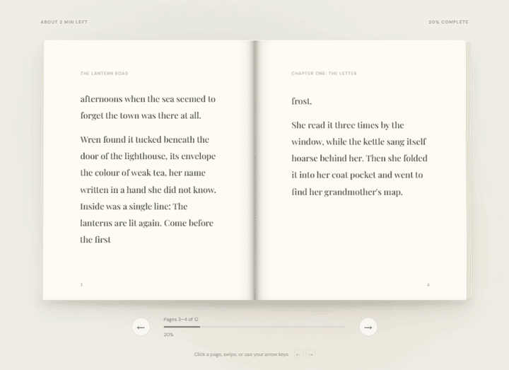
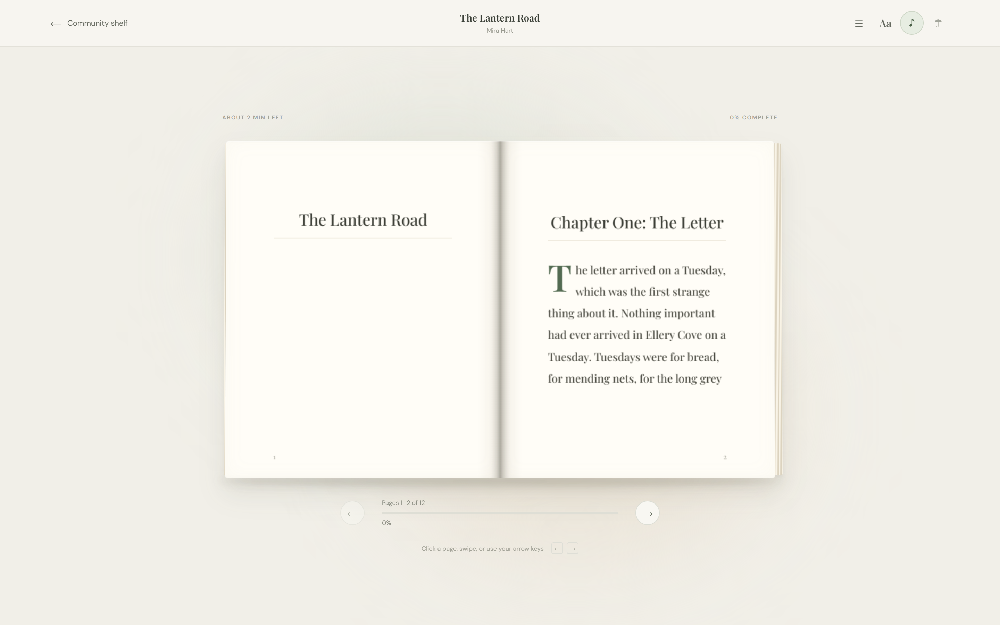
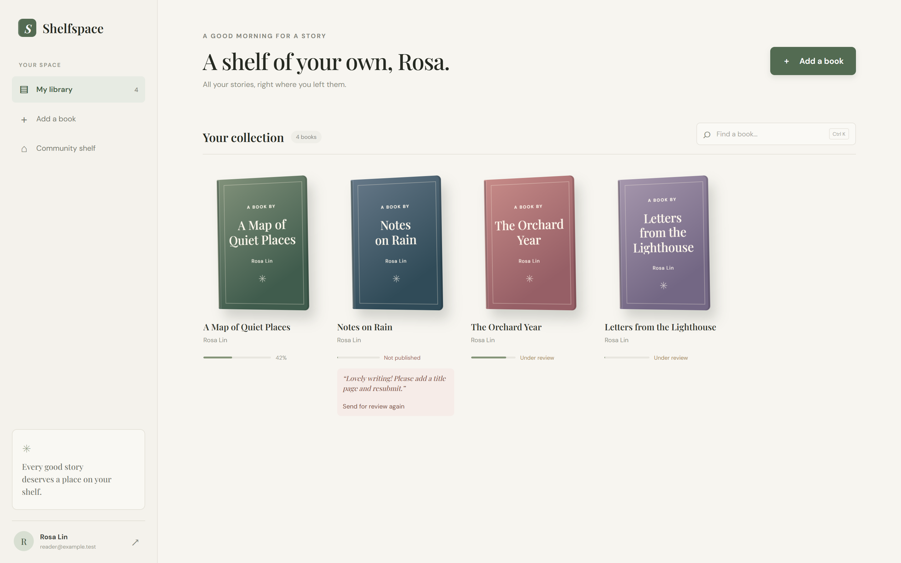
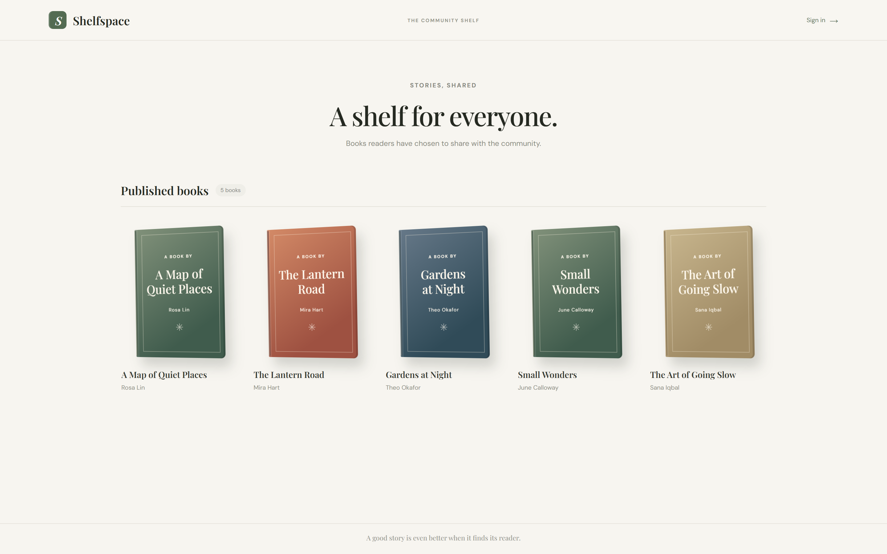
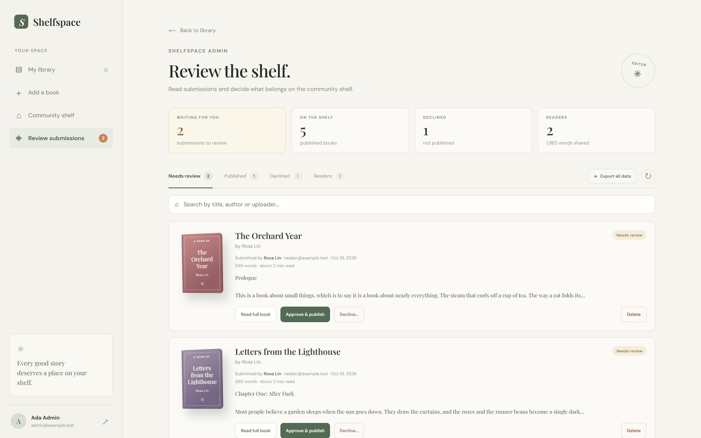
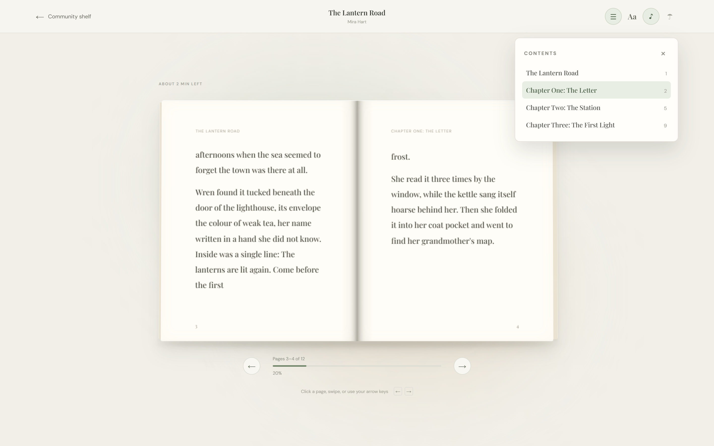
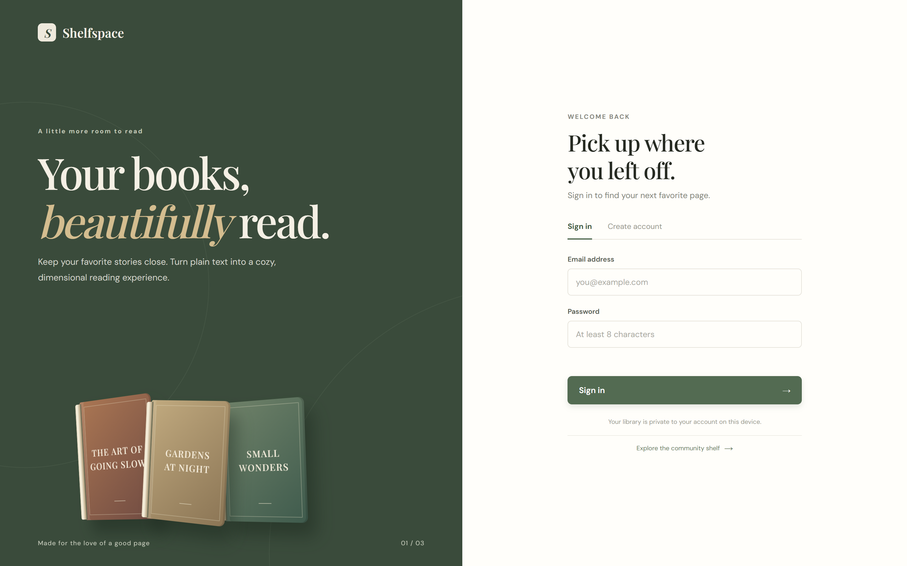
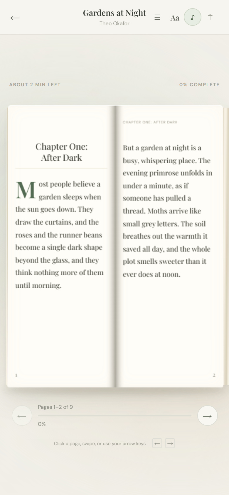
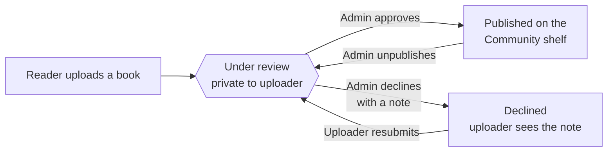

<p align="center">
  
</p>

<p align="center">
  <a href="https://shelfspace-u4i2.onrender.com"></a>
  
  
  
</p>

<p align="center">
  <b><a href="https://shelfspace-u4i2.onrender.com">Open the live site</a></b> ·
  <a href="#-features">Features</a> ·
  <a href="#-screenshots">Screenshots</a> ·
  <a href="#-quick-start">Quick start</a> ·
  <a href="#-deploy-your-own">Deploy</a> ·
  <a href="#%EF%B8%8F-how-publishing-works">Publishing</a>
</p>

---

**Shelfspace** turns plain `.txt` and `.md` files into a cozy, dimensional reading experience. Upload a book, give it a cover, and read it in a two-page 3D book that turns real pages, with soft paper sounds if you like. Books stay private until an admin approves them for the public **Community shelf**.

It is a single small Node.js server with **no npm dependencies**: no framework, no database and no build step.

<p align="center">
  
</p>

## ✨ Features

<table>
<tr>
<td width="50%" valign="top">

### 📖 A reader that feels like a book
- The cover **swings open** on its spine when you start reading
- Pages turn as **real 3D leaves** with light and shadow
- Page edges thicken on the side you have already read
- The book **leans toward your mouse**, like holding it in your hands
- Pages **re-flow to fit your screen**, with three text sizes

</td>
<td width="50%" valign="top">

### ✍️ Plain text, printed-book typography
- `Chapter 1`, `Part Two`, `Prologue` and `#`/`##` headings become **chapters**
- Each chapter opens on a fresh page with a **drop cap**
- Running heads show the book title and current chapter
- A **☰ Contents** panel lets you jump between chapters
- Markdown bold, quotes and `---` rules are tidied up

</td>
</tr>
<tr>
<td width="50%" valign="top">

### 🎧 Sound and atmosphere
- Soft **paper sounds** for turning, opening and closing
- An optional **☂ rain ambience** for cozy reading
- All audio is synthesized in the browser: no audio files
- Your sound choice is remembered on that device

</td>
<td width="50%" valign="top">

### 🛡️ Admin-approved community shelf
- New uploads stay **private and under review**
- Admins **approve & publish** or **decline with a note**
- Uploaders see the note and can **resubmit**
- Dashboard with counts, search, word counts and a **Readers** tab
- Promote other admins, unpublish, delete or **export everything**

</td>
</tr>
</table>

Also included: accounts with salted PBKDF2 passwords, reading progress that saves as you go, six cover styles or your own image, library search (<kbd>Ctrl</kbd>/<kbd>⌘</kbd>+<kbd>K</kbd>), swipe on touch screens, and reduced-motion support.

## 📸 Screenshots

<table>
<tr>
<td colspan="2"></td>
</tr>
<tr>
<td width="50%"><p align="center"><sub><b>Your library</b>: covers, progress and review status</sub></p></td>
<td width="50%"><p align="center"><sub><b>Community shelf</b>: published books anyone can read</sub></p></td>
</tr>
<tr>
<td width="50%"><p align="center"><sub><b>Admin review</b>: approve, decline with a note, or delete</sub></p></td>
<td width="50%"><p align="center"><sub><b>Contents</b>: jump straight to any chapter</sub></p></td>
</tr>
<tr>
<td width="50%"><p align="center"><sub><b>Sign in</b> or create an account</sub></p></td>
<td width="50%" align="center"><p align="center"><sub><b>On a phone</b>: tap or swipe to turn</sub></p></td>
</tr>
</table>

## 🚀 Quick start

You need [Node.js](https://nodejs.org) 18 or newer. There is nothing to install.

```bash
git clone https://github.com/digvijay165/Shelfspace.git
cd Shelfspace
npm start
```

Open **http://127.0.0.1:4173**, create an account and add a `.txt` or `.md` book.

**Become the admin locally:** create `admin-email.txt` beside `server.js` containing your email *before* you sign up. The file is git-ignored. Or promote an existing account:

```bash
npm run admin:promote -- you@example.com
```

Want sample books to play with? Start with `DEMO_SEED=1` to fill an empty library with four original short stories:

```bash
DEMO_SEED=1 DATA_FILE=./demo-data.json npm start
```

## 🌍 Deploy your own

[](https://render.com/deploy?repo=https://github.com/digvijay165/Shelfspace)

1. Click **Deploy to Render** and sign in with GitHub.
2. When asked for `ADMIN_EMAIL`, enter the email you will sign up with. That account becomes the site owner.
3. When the deploy finishes, open your `onrender.com` link and create your account with that email.

The included [`render.yaml`](render.yaml) sets everything else (`HOST`, `TRUST_PROXY`, the `/healthz` health check and the demo shelf).

> [!NOTE]
> On Render's free plan, the server's disk is wiped whenever the service restarts or redeploys, and the service sleeps after 15 minutes idle (the next visit takes about a minute to wake). For a library that lasts, attach a persistent disk and set `DATA_FILE=/var/data/data.json`.

## 🗂️ How publishing works



Only published books are ever served publicly. Every admin endpoint checks the signed-in role on the server, and the site owner (`ADMIN_EMAIL`) can never lose admin access.

## ⚙️ Configuration

| Variable | Default | What it does |
| --- | --- | --- |
| `PORT` | `4173` | Port to listen on |
| `HOST` | `127.0.0.1` | Interface to bind; use `0.0.0.0` on a host |
| `DATA_FILE` | `./data.json` | Where accounts and books are stored |
| `ADMIN_EMAIL` | contents of `admin-email.txt` | The site owner's email, who always has admin access |
| `TRUST_PROXY` | off | Set to `1` behind an HTTPS proxy so cookies are marked `Secure` |
| `DEMO_SEED` | off | Set to `1` to add sample books when the library is empty |

## ⌨️ Reader controls

| Action | How |
| --- | --- |
| Turn the page | <kbd>→</kbd> / <kbd>←</kbd>, <kbd>Page Down</kbd> / <kbd>Page Up</kbd>, click a page, or swipe |
| First / last page | <kbd>Home</kbd> / <kbd>End</kbd> |
| Contents | **☰** in the reader header |
| Text size | **Aa** cycles small, medium and large |
| Sounds / rain | **♪** and **☂** |
| Close the book | <kbd>Esc</kbd> |
| Search your library | <kbd>Ctrl</kbd>/<kbd>⌘</kbd> + <kbd>K</kbd> |

## 🧱 Project structure

```text
Shelfspace/
├── server.js            # HTTP server, JSON API, auth, review workflow
├── demo/books.js        # Original sample stories for the demo shelf
├── public/
│   ├── index.html       # The single-page app shell
│   ├── app.js           # Library, admin dashboard, 3D reader, pagination
│   ├── sound.js         # Paper sounds and rain, synthesized with Web Audio
│   ├── styles.css       # Core look and layout
│   ├── moderation.css   # Admin and community shelf styles
│   └── experience.css   # 3D book, page turns, reader tools, dashboard
├── scripts/
│   └── screenshots.js   # Regenerates docs/screenshots with headless Chrome
├── docs/                # Banner, logo, screenshots and the page-turn GIF
└── render.yaml          # One-click Render blueprint
```

<details>
<summary><b>API reference</b></summary>

| Method | Path | Who | Purpose |
| --- | --- | --- | --- |
| `POST` | `/api/register`, `/api/login`, `/api/logout` | anyone | Accounts and sessions |
| `GET` | `/api/me` | anyone | The signed-in user, if any |
| `GET` | `/api/public/books`, `/api/public/books/:id` | anyone | Published books |
| `GET` `POST` | `/api/books` | reader | List or upload your books |
| `GET` `DELETE` | `/api/books/:id` | owner | Read or remove your book |
| `PATCH` | `/api/books/:id/progress` | owner | Save reading progress |
| `POST` | `/api/books/:id/resubmit` | owner | Send a declined book back for review |
| `GET` | `/api/admin/books?status=` | admin | Review queue (`pending`, `published`, `rejected`, `all`) |
| `GET` `DELETE` | `/api/admin/books/:id` | admin | Read or delete any submission |
| `PATCH` | `/api/admin/books/:id/status` | admin | Publish, decline (with `note`) or return to review |
| `GET` | `/api/admin/users` | admin | Accounts with upload counts |
| `PATCH` | `/api/admin/users/:id/role` | admin | Make someone an admin or a reader |
| `GET` | `/api/admin/export` | admin | Download all data as JSON (no passwords or hashes) |

</details>

<details>
<summary><b>Notes and limits</b></summary>

- Text files can be up to 2 MB; cover images (PNG, JPG, WebP, GIF) up to 1 MB. Both are stored in the JSON data file.
- Sessions live in memory, so everyone signs in again after a server restart.
- The admin export contains book text, covers, statuses and account names and emails, but never passwords, hashes or session tokens.
- Google Fonts are optional; the interface falls back to system serif and sans-serif fonts offline.
- Regenerate the screenshots with `node scripts/screenshots.js`, which needs Chrome or Edge installed.

</details>

---

<p align="center">
  <br>
  <sub>Made for the love of a good page.</sub>
</p>
